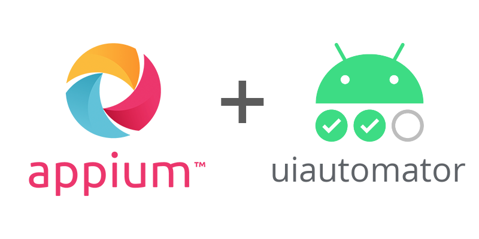

## Appium UiAutomator2 Driver

   

---

<b>
   <a href="https://appium.github.io/appium-uiautomator2-driver/">Documentation</a> |
   <a href="https://appium.github.io/appium-uiautomator2-driver/latest/getting-started/">Get Started</a> |
   <a href="https://github.com/appium/appium-uiautomator2-driver/blob/master/CHANGELOG.md">Changelog</a>
</b>

---

This is a black-box Appium driver for automating native and hybrid applications on Android, using
Android's UI Automator framework.

> [!IMPORTANT]
> Since major version *9.0.0*, this driver is only compatible with Appium 4.

## Documentation

You can access the documentation here: [**https://appium.github.io/appium-uiautomator2-driver**](https://appium.github.io/appium-uiautomator2-driver)
